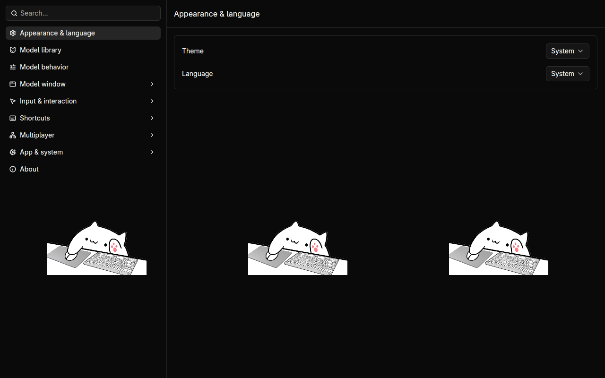
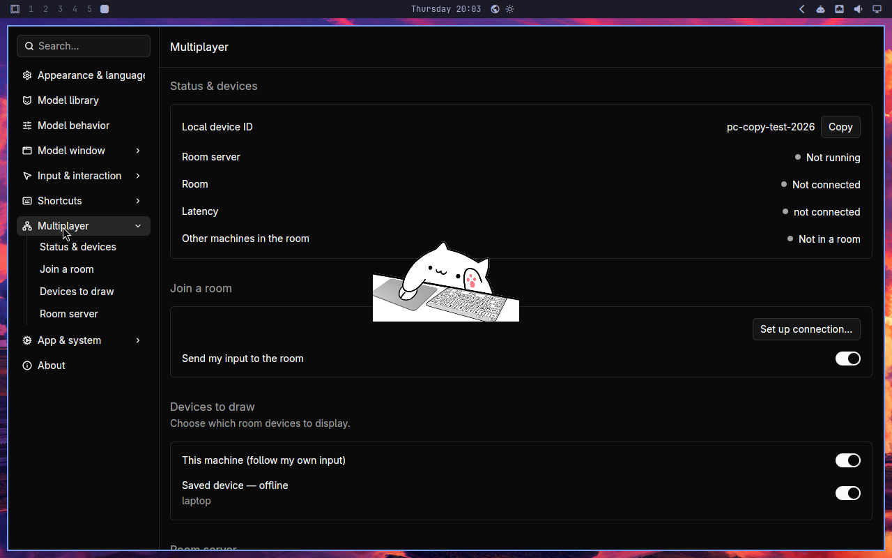
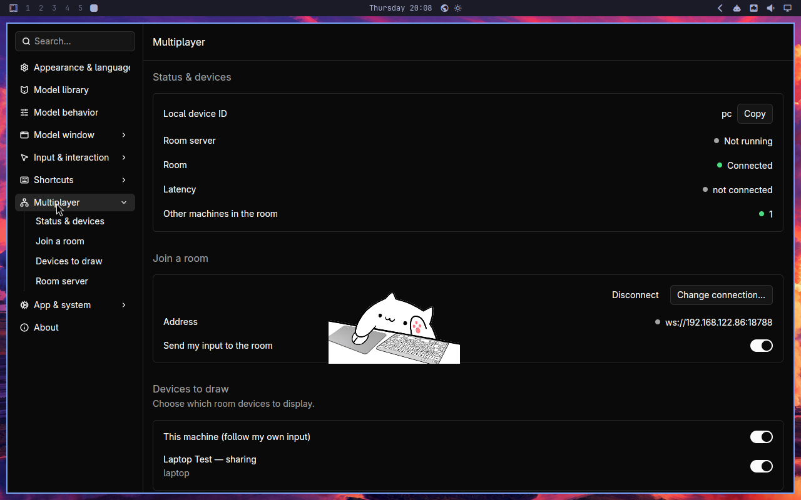
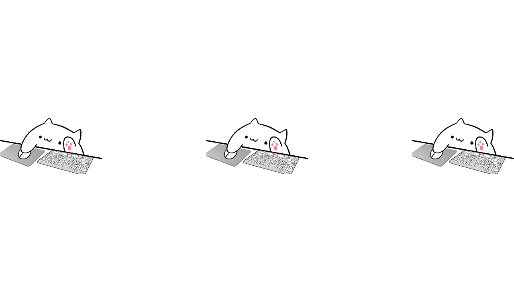

<div align="center">

English | [简体中文](README.zh-CN.md)

</div>

<div align="center">
  <div>
    <a href="https://github.com/ayangweb/BongoCat/releases"></a>
    <a href="https://github.com/ayangweb/BongoCat/releases"></a>
  </div>

  <p>
    <a href="./LICENSE"></a>
    <a href="https://github.com/ayangweb/BongoCat/releases/latest"></a>
    <a href="https://github.com/ayangweb/BongoCat/releases"></a>
  </p>

  <p>
    <a href="https://trendshift.io/developers/8507" target="_blank"></a>
    <a href="https://trendshift.io/repositories/14605" target="_blank"></a>
    <a href="https://hellogithub.com/repository/7d23863fd4be47b39e816193ded385c9" target="_blank">
      <picture>
        <source media="(prefers-color-scheme: dark)" srcset="https://abroad.hellogithub.com/v1/widgets/recommend.svg?rid=7d23863fd4be47b39e816193ded385c9&claim_uid=5ihRVIuTYBmSGtQ&theme=dark" />
        <source media="(prefers-color-scheme: light)" srcset="https://abroad.hellogithub.com/v1/widgets/recommend.svg?rid=7d23863fd4be47b39e816193ded385c9&claim_uid=5ihRVIuTYBmSGtQ&theme=neutral" />
        
      </picture>
    </a>
  </p>
</div>

<table width="100%">
  <thead>
    <tr>
      <th width="50%" align="center">macOS</th>
      <th width="50%" align="center">Windows</th>
    </tr>
  </thead>
  <tbody>
    <tr>
      <td width="50%" align="center"></td>
      <td width="50%" align="center"></td>
    </tr>
  </tbody>
</table>

BongoCat is a desktop companion for Windows and macOS. A Live2D cat lives on your screen, its eyes
and paws follow your mouse, and it reacts to every key, mouse button and gamepad button you press.
Bring your own models, move the window wherever you like, and it stays out of your way until you
want it again.

Inspired by [Bongo-Cat-Mver](https://github.com/MMmmmoko/Bongo-Cat-Mver) by
[MMmmmoko](https://github.com/MMmmmoko).

## About this fork

This is a personal fork of [ayangweb/BongoCat](https://github.com/ayangweb/BongoCat), kept for
its author's own machines. It is **not** the upstream project: issues opened here do not reach
upstream, and this fork does not promise to stay compatible with upstream releases. Everything
it starts from belongs to upstream; the changes below are what this fork adds on top.

- **Linux / Wayland support.** Built on top of
  [PR #1114](https://github.com/ayangweb/BongoCat/pull/1114) by
  [@xiaozhangup](https://github.com/xiaozhangup), which ports the pet to Linux through a
  layer-shell overlay (tested on Hyprland).
- **OBS Alpha output on Linux.** Send the currently displayed cat to OBS through an optional
  transparent virtual camera, including when the cat follows another device.
- **Cross-device multiplayer.** Inspired by the room-key + relay design of
  [JMTeCHNoLOGY/BongoCat](https://github.com/JMTeCHNoLOGY/BongoCat), reimplemented from scratch
  for this codebase in `crates/bongocat-net`: one machine serves a room with `--relay`, and
  another machine joins it — `--publish-url` sends that machine's input to the room, `--watch`
  draws another machine's pet instead of its own. The settings window carries a multiplayer
  page with the same parts (this machine, devices to draw, join a room, serve a relay) plus a
  live status group. The multiplayer runtime is wired up on Linux today; on other platforms
  the page can be configured but nothing joins.
- The rest of this README describes the upstream project, so lines like "runs on macOS and
  Windows" or "works offline" no longer hold for this fork.

This fork is licensed under the same [Apache License 2.0](./LICENSE) as upstream, and the
upstream authors hold the copyright to everything this fork starts from.

## Features added in this fork

The Linux work builds on [Wayland support in PR #1114](https://github.com/ayangweb/BongoCat/pull/1114).
This fork adds multiplayer, per-device window placement, and a transparent OBS source.

### Three cats on one desktop

Show the local cat and up to two remote cats in separate windows. Each follows its own device input and restores its position by device ID.



### Multiplayer status and device controls

The status panel shows the local device ID with a Copy button. Use the switches below to choose which room devices to display.





### One transparent source for OBS

The Linux V4L2 camera composites the selected cats into one transparent frame and preserves their relative positions. This image is a captured camera frame.



## Run the Linux build

From the repository root, build the Development version with:

```sh
just build --environment development --target x86_64-unknown-linux-gnu
```

Run the versioned executable in `target/package/`. For version 2.4.1, use
`./target/package/BongoCat-2.4.1-linux-x64.bin`.

### Where Linux saves cat positions

On Wayland layer-shell, BongoCat saves cat positions by device ID in the
local build environment’s `window-state.json` on normal exit. Selecting the
same device again restores its position. Ordinary Wayland windows are
positioned by the compositor.

In Multiplayer, choose up to two remote devices by display name to show
alongside the local cat. Use the room server settings to host a room on
this machine.

## Transparent OBS source on Linux

The camera outputs the selected cats together in a single transparent frame.
Their relative positions follow the local layout. A selected device that
goes offline leaves a transparent gap until it reconnects.

The Alpha output is available on Linux / Wayland. It has been checked with OBS 33.0.1 and
v4l2loopback 0.15.4; support in other combinations depends on their Alpha format support.

1. Install the v4l2loopback driver and `v4l2loopback-ctl` using your distribution's packages.
   The system also needs `pkexec`, a running graphical polkit authentication agent and udev.
   BongoCat does not install the driver.
2. In **Settings → Model window → Alpha output**, select **Refresh**, then
   **Install virtual camera** and approve the system authorization. Turn on
   **Enable Alpha output**. The switch is off by default.
3. In OBS, add a **Video Capture Device** source and choose **BongoCat Alpha**
   (or **BongoCat Alpha (Development)** for a development build). The source carries the cat
   and model artwork with transparency at 1280 × 720 and 30 FPS. Keyboard and pointer input
   follow the devices selected in BongoCat's multiplayer settings.

After upgrading an existing Alpha installation to the current version, select
**Install virtual camera** once and authorize it to update the device identity record.
The existing camera is kept when its recorded device still matches.

The camera is not recreated automatically after a system restart. Return to Alpha output and
install it again with authorization; if output reports an error, select **Retry output**.
To remove it, select **Uninstall virtual camera** and authorize the operation. This stops
Alpha output and removes BongoCat's camera and permission rule; the driver and other cameras
remain installed.

## Features

- Runs on macOS and Windows.
- Matches the right motion to every key, mouse button or gamepad button you press.
- Bring your own Live2D models and make the cat your own.
- Fully open source, public code, and no collection of user data.
- Works offline with no network access, so your privacy is protected.

## More models

You can browse and download more cat models, or share your own, in
[Awesome-BongoCat](https://github.com/ayangweb/Awesome-BongoCat).

## Community

<table>
  <thead>
    <tr>
      <th>QQ Group 1</th>
      <th>QQ Group 2</th>
    </tr>
  </thead>
  <tbody>
    <tr>
      <td>
        <a href="https://qm.qq.com/q/AS3gNv2Vzy">
          <picture>
            <source
              media="(prefers-color-scheme: dark)"
              srcset="https://i0.hdslb.com/bfs/openplatform/8ecdc4982ab01b59d7731fcca3ec26631a274560.png"
            />
            <source
              media="(prefers-color-scheme: light)"
              srcset="https://i0.hdslb.com/bfs/openplatform/09f56580397063e1819c4c2ed63d07dee12720e1.png"
            />
            
          </picture>
        </a>
      </td>
      <td>
        <a href="https://qm.qq.com/q/TmltLAod2O">
          <picture>
            <source
              media="(prefers-color-scheme: dark)"
              srcset="https://i0.hdslb.com/bfs/openplatform/473c522487ff33e0f32b15466aeb0734f17161c8.png"
            />
            <source
              media="(prefers-color-scheme: light)"
              srcset="https://i0.hdslb.com/bfs/openplatform/d5ae8c5af6ae1d0a1f066705ee822d1287384cf6.png"
            />
            
          </picture>
        </a>
      </td>
    </tr>
  </tbody>
</table>

## Support

Every bit of recognition is appreciated. Donations are welcome, but never expected — thank you for
loving the cat ❤️

<picture>
  <source media="(prefers-color-scheme: dark)" srcset="https://i0.hdslb.com/bfs/openplatform/e7438bff14cdfb6bfd0feacbb482f99ea4093294.png" />
  <source media="(prefers-color-scheme: light)" srcset="https://i0.hdslb.com/bfs/openplatform/da55cc3ec1556580c91e59f589792866c998c7c6.png" />
  
</picture>

## Contributing

Contributions are very welcome. Please read the [contributing guide](CONTRIBUTING.md).

<a href="https://openomy.com/ayangweb/BongoCat" target="_blank" style="display: block; width: 100%;" align="center">
  
</a>

## Star history

<a href="https://www.star-history.com/#ayangweb/BongoCat&Date">
 <picture>
   <source media="(prefers-color-scheme: dark)" srcset="https://api.star-history.com/svg?repos=ayangweb/BongoCat&type=Date&theme=dark" />
   <source media="(prefers-color-scheme: light)" srcset="https://api.star-history.com/svg?repos=ayangweb/BongoCat&type=Date" />
   
 </picture>
</a>

## License

BongoCat is open source under the [Apache License 2.0](LICENSE) license.
