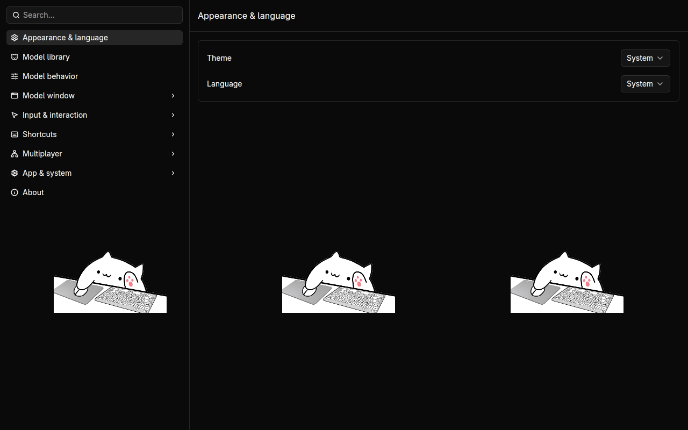
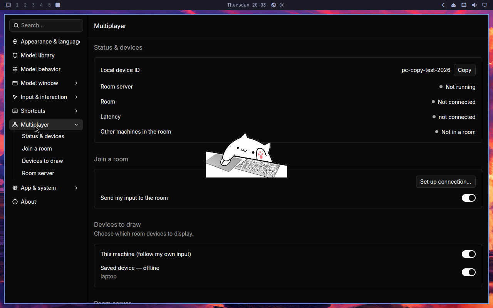
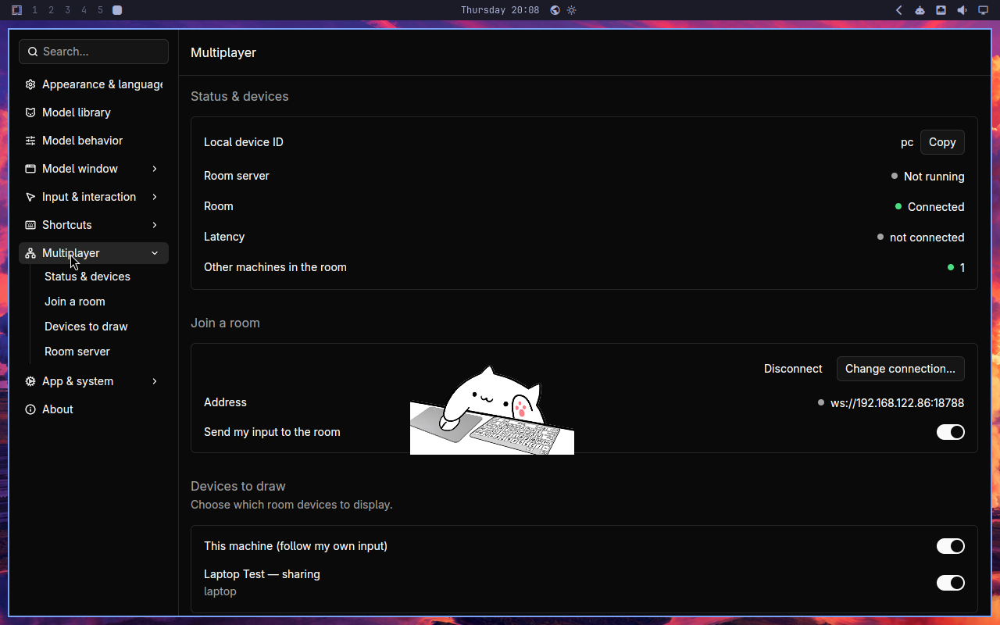
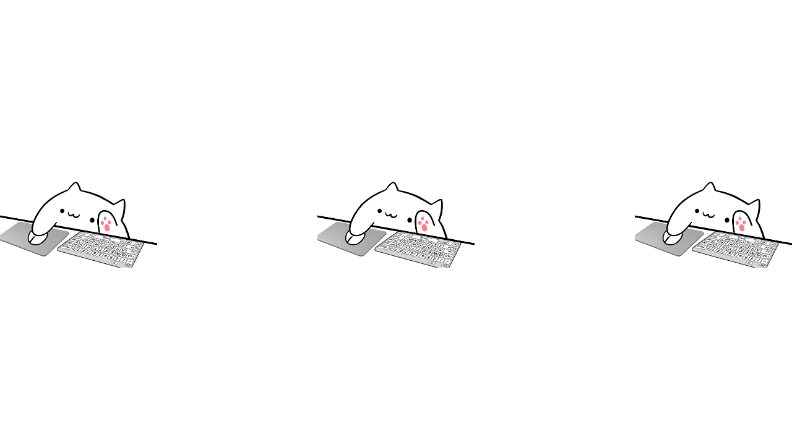

<div align="center">

[English](README.md) | 简体中文

</div>

<div align="center">
  <div>
    <a href="https://github.com/ayangweb/BongoCat/releases"></a>
    <a href="https://github.com/ayangweb/BongoCat/releases"></a>
  </div>

  <p>
    <a href="./LICENSE"></a>
    <a href="https://github.com/ayangweb/BongoCat/releases/latest"></a>
    <a href="https://github.com/ayangweb/BongoCat/releases"></a>
  </p>

  <p>
    <a href="https://trendshift.io/developers/8507" target="_blank"></a>
    <a href="https://trendshift.io/repositories/14605" target="_blank"></a>
    <a href="https://hellogithub.com/repository/7d23863fd4be47b39e816193ded385c9" target="_blank">
      <picture>
        <source media="(prefers-color-scheme: dark)" srcset="https://abroad.hellogithub.com/v1/widgets/recommend.svg?rid=7d23863fd4be47b39e816193ded385c9&claim_uid=5ihRVIuTYBmSGtQ&theme=dark" />
        <source media="(prefers-color-scheme: light)" srcset="https://abroad.hellogithub.com/v1/widgets/recommend.svg?rid=7d23863fd4be47b39e816193ded385c9&claim_uid=5ihRVIuTYBmSGtQ&theme=neutral" />
        
      </picture>
    </a>
  </p>
</div>

<table width="100%">
  <thead>
    <tr>
      <th width="50%" align="center">macOS</th>
      <th width="50%" align="center">Windows</th>
    </tr>
  </thead>
  <tbody>
    <tr>
      <td width="50%" align="center"></td>
      <td width="50%" align="center"></td>
    </tr>
  </tbody>
</table>

BongoCat 是一款面向 Windows 和 macOS 的桌面陪伴应用。一只 Live2D 小猫住在你的屏幕上，眼神和爪子会跟着鼠标移动，你按下的每个按键、鼠标键和手柄按键它都会有反应。你可以换上自己的模型，把窗口拖到任何位置，需要的时候它就安静地待在一边。

灵感来自 [MMmmmoko](https://github.com/MMmmmoko) 的 [Bongo-Cat-Mver](https://github.com/MMmmmoko/Bongo-Cat-Mver)。

## 关于这个 fork

这是 [ayangweb/BongoCat](https://github.com/ayangweb/BongoCat) 的个人 fork，仅供其作者自己的
几台机器使用。它**不是**上游项目：在这里提的 issue 到不了上游，这个 fork 也不保证与上游版本
保持兼容。它所基于的一切都属于上游，下面的改动是这个 fork 自己加的。

- **Linux / Wayland 支持。** 基于 [@xiaozhangup](https://github.com/xiaozhangup) 的
  [PR #1114](https://github.com/ayangweb/BongoCat/pull/1114) 构建，通过 layer-shell overlay
  把桌面宠物移植到 Linux（在 Hyprland 上实测）。
- **Linux OBS Alpha 输出。** 可通过透明虚拟摄像头将当前显示的猫发送到 OBS，也支持
  跟随其他设备输入的猫。
- **跨设备联机。** 参考 [JMTeCHNoLOGY/BongoCat](https://github.com/JMTeCHNoLOGY/BongoCat) 的
  房间密钥 + relay 设计，在本仓库的代码里从头重新实现（`crates/bongocat-net`）：一台机器用
  `--relay` 开房间，另一台加入它——`--publish-url` 把那台机器的输入推送到房间，`--watch` 则
  画另一台机器的猫而不是自己的。设置窗口里有对应的联机页（本机、要画的设备、加入房间、
  开启联机服务），底部还有实时状态。联机运行时目前只在 Linux 上接入；其他平台上这一页
  可以配置但不会生效。
- 本 README 其余部分描述的是上游项目，所以类似「适配 macOS、Windows」「支持离线运行」的说法
  对这个 fork 不再成立。

本 fork 与上游一样采用 [Apache License 2.0](./LICENSE) 授权，本 fork 所基于代码的版权归上游
作者所有。

## 本 fork 新增功能

Linux 版本基于 [PR #1114 的 Wayland 支持](https://github.com/ayangweb/BongoCat/pull/1114)。
本 fork 新增跨设备联机、按设备保存窗口位置和 OBS 透明输出。

### 三猫同屏

本机猫和最多两只远端猫可以在独立窗口中同时显示，各自跟随对应设备输入，并按设备 ID 恢复位置。



### 联机状态和展示设备

状态区显示本机设备 ID，支持一键复制。下方可用开关选择要显示的房间设备。





### OBS 单路透明输出

Linux V4L2 虚拟摄像头把选中的猫合成到同一个透明画面，保留各只猫的相对位置。下图是摄像头实际采集的一帧。



## 运行 Linux 构建

在仓库根目录构建 Development 版本：

```sh
just build --environment development --target x86_64-unknown-linux-gnu
```

运行 `target/package/` 下带版本号的可执行文件。以 2.4.1 为例，运行
`./target/package/BongoCat-2.4.1-linux-x64.bin`。

### Linux 如何保存猫的位置

使用 Wayland layer-shell 时，正常退出会按设备 ID，把各只猫的位置写入本机当前构建环境的
`window-state.json`。重新选中同一设备会恢复它的位置。普通 Wayland 窗口的位置由合成器管理。

在联机页按显示名称从房间名单选择最多两台远端设备，和本机猫一起展示。使用「服务端」设置可以在本机开房间。

## 在 Linux 中向 OBS 输出透明画面

一台虚拟摄像头把选中的猫合成到同一个透明画面。各只猫的相对位置沿用本机布局，
已选设备离线时留出透明空位，其他猫的位置保持不变。

Alpha 输出适用于 Linux / Wayland，已在 OBS 33.0.1 和 v4l2loopback 0.15.4 上验证。
其他版本的可用性取决于其对 Alpha 格式的支持。

1. 使用发行版的软件包安装 v4l2loopback 驱动和 `v4l2loopback-ctl`。系统还需要
   `pkexec`、正在运行的图形 polkit 授权代理和 udev。BongoCat 不会安装驱动。
2. 打开「设置 → 模型窗口 → Alpha 输出」，点击「重新检测」，再点击「安装虚拟摄像头」并完成
   系统授权，然后开启「启用 Alpha 输出」。开关默认关闭。
3. 在 OBS 中添加「视频采集设备」源，选择 **BongoCat Alpha**；开发构建选择
   **BongoCat Alpha (Development)**。画面包含猫和模型素材，保留透明背景，输出规格为
   1280 × 720、30 FPS；键盘和鼠标输入跟随 BongoCat 联机设置中选定的设备。

从已有 Alpha 输出版本升级后，请在设置页再点击一次「安装虚拟摄像头」并授权，以更新设备
身份记录。已记录的设备仍然匹配时，这一步会保留现有摄像头。

系统重启后，虚拟摄像头不会自动恢复。请回到 Alpha 输出设置重新安装并授权；若输出显示错误，
点击「重试输出」。如需移除，点击「卸载虚拟摄像头」并授权：这会停止 Alpha 输出，移除
BongoCat 的摄像头及其权限规则，保留驱动和其他摄像头。

## 功能介绍

- 适配 macOS、Windows。
- 根据键盘、鼠标或手柄的操作，同步对应的动作。
- 支持导入自定义模型，自由打造专属猫咪形象。
- 完全开源，代码公开透明，绝不收集任何用户数据。
- 支持离线运行，无需联网，保护用户隐私。

## 更多模型

你可以在 [Awesome-BongoCat](https://github.com/ayangweb/Awesome-BongoCat) 里浏览、下载更多猫咪模型，或分享自己的创作。

## 社区交流

<table>
  <thead>
    <tr>
      <th>QQ 群 1</th>
      <th>QQ 群 2</th>
    </tr>
  </thead>
  <tbody>
    <tr>
      <td>
        <a href="https://qm.qq.com/q/AS3gNv2Vzy">
          <picture>
            <source
              media="(prefers-color-scheme: dark)"
              srcset="https://i0.hdslb.com/bfs/openplatform/8ecdc4982ab01b59d7731fcca3ec26631a274560.png"
            />
            <source
              media="(prefers-color-scheme: light)"
              srcset="https://i0.hdslb.com/bfs/openplatform/09f56580397063e1819c4c2ed63d07dee12720e1.png"
            />
            
          </picture>
        </a>
      </td>
      <td>
        <a href="https://qm.qq.com/q/TmltLAod2O">
          <picture>
            <source
              media="(prefers-color-scheme: dark)"
              srcset="https://i0.hdslb.com/bfs/openplatform/473c522487ff33e0f32b15466aeb0734f17161c8.png"
            />
            <source
              media="(prefers-color-scheme: light)"
              srcset="https://i0.hdslb.com/bfs/openplatform/d5ae8c5af6ae1d0a1f066705ee822d1287384cf6.png"
            />
            
          </picture>
        </a>
      </td>
    </tr>
  </tbody>
</table>

## 赞赏

每一份认可都值得被珍视！赞赏随缘，心意无价，谢谢你的支持 ❤️

<picture>
  <source media="(prefers-color-scheme: dark)" srcset="https://i0.hdslb.com/bfs/openplatform/e7438bff14cdfb6bfd0feacbb482f99ea4093294.png" />
  <source media="(prefers-color-scheme: light)" srcset="https://i0.hdslb.com/bfs/openplatform/da55cc3ec1556580c91e59f589792866c998c7c6.png" />
  
</picture>

## 贡献指南

感谢大家为 BongoCat 做出的贡献！如果也希望为 BongoCat 添砖加瓦，请查阅[贡献指南](CONTRIBUTING.zh-CN.md)。

<a href="https://openomy.com/ayangweb/BongoCat" target="_blank" style="display: block; width: 100%;" align="center">
  
</a>

## 历史星标

<a href="https://www.star-history.com/#ayangweb/BongoCat&Date">
 <picture>
   <source media="(prefers-color-scheme: dark)" srcset="https://api.star-history.com/svg?repos=ayangweb/BongoCat&type=Date&theme=dark" />
   <source media="(prefers-color-scheme: light)" srcset="https://api.star-history.com/svg?repos=ayangweb/BongoCat&type=Date" />
   
 </picture>
</a>

## 开源协议

BongoCat 基于 [Apache License 2.0](LICENSE) 开源。
